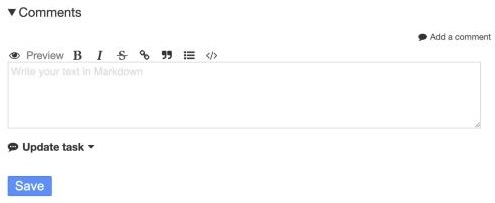
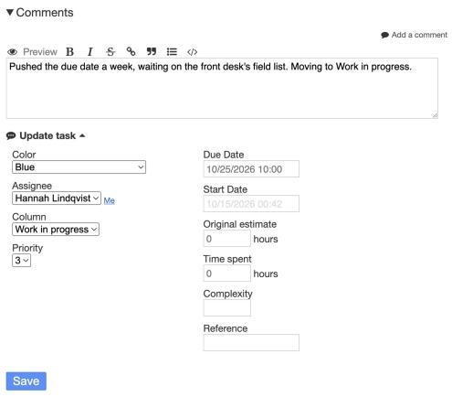
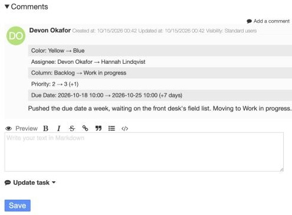
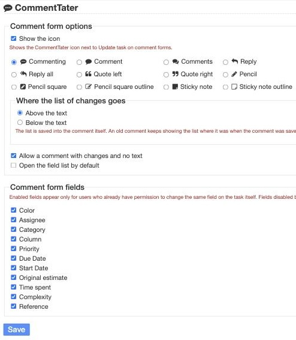

# CommentTater

*CommentTater* is a [Kanboard](https://kanboard.org) plugin that lets you update a task's fields while posting a comment. Changes made to the task from the comment are shown on the posted comment and are included in Kanboard email notifications, too.

Without *CommentTater*, you edit the task in one form and post a comment about it in another. With *CommentTater*, write up your comment, click the *Update task* dropdown, change a field, and save. *CommentTater* saves the comment and updates the task at the same time like other project management systems.

Settings let you set the *CommentTater* icon, choose where the task's changes appear in the comment (either above or below the comment text), allow comments to be posted with changes but without any text, and choose whether or not the *Update task* dropdown is open by default.

## Screenshots

The comment form has an *Update task* dropdown under the comment text field. Admins can choose whether or not it's open by default.

Task fields are displayed when the *Update task* dropdown is expanded. Write up your comment, click *Update task*, change a field, and save.

The comment shows what changed.

At *Settings -> CommentTater*, admins can choose the icon, the enabled fields, if comments can be posted with changes and no text, and whether or not the *Update task* dropdown is open by default, and where the list of task changes is displayed.

## Quick start

1. Copy the `CommentTater` folder into Kanboard's `plugins/` directory.
2. Reload PHP-FPM if OPcache is on and a changed file doesn't show up, since OPcache can serve the old copy for a few minutes.
3. Open a task and click *Add a comment*. The *Update task* dropdown shows under the comment text box.
4. Optionally choose which fields to enable, the icon CommentTater uses, and where the list of task updates shown on comments goes under *Settings -> CommentTater*.

[INSTALL.md](INSTALL.md) covers the requirements, removal, updating, and conflicts.

## The fields

CommentTater's *Update task* form copies the same form fields as Kanboard's task edit form, so dates, assignees, priorities, etc. all work the same way. If a user can see a field and change it on the task, they can change it in CommentTater's comment form.

| Field | What it changes | What the list shows |
|---|---|---|
| Color | The task's card color | Old and new color names |
| Assignee | The task's owner | Old and new names, or "Unassigned" |
| Category | The task's category | Old and new names, or "No category" |
| Column | Moves the card to another column (and swimlane, when the project has more than one) | "Swimlane › Column" for each place, or just the column when the project has one swimlane |
| Priority | The task's priority | Old and new numbers and the difference, such as "+2" |
| Due Date | The due date | Old and new dates and the difference in days, such as "+7 days" |
| Start Date | The start date | Same as Due Date |
| Original estimate | Estimated hours | Old and new hours and the difference, such as "+1.5h" |
| Time spent | Hours spent | Same as Original estimate |
| Complexity | The task's complexity score | Same as Priority |
| Reference | The task's reference | Old and new text, or "none" |

Each change is saved to the comment as a Markdown list item, like `- Priority: 1 → 3 (+2)`, above or below your text. Kanboard renders it as a list and CommentTater stripes rows.

The form remembers what each field was shown at the time that it was opened, so if another user changed the task while you were writing your comment your comment won't overwrite their change.

- You get fields in *Update task* only when you may edit the task. A user who can only comment sees the block open with the note "No fields to change on this task."
- Assignee shows only when you may change a task's assignee.
- Category shows only when the project has categories.
- Column shows only on an open task, only where the board would let you drag that card, and only with destinations the board would let you move it to. A project role with move restrictions applies, so the form follows the board.
- An admin can drop any field for everyone. See Settings.

A request that edits a field a user can't change isn't saved and a "You are not allowed to change this field." error is displayed, so a forged request won't do anything.

## Settings

Settings are in *Settings -> CommentTater*.

| Setting | What it does | Default |
|---|---|---|
| Show the icon | Shows the *CommentTater* icon next to *Update task* on comment forms. The settings page title keeps its icon either way | On |
| Icon | The icon to show: Commenting, Comment, Comments, Reply, Reply all, Quote left, Quote right, Pencil, Pencil square, Pencil square outline, Sticky note, or Sticky note outline | Commenting |
| Comment form fields | One checkbox for each of the eleven fields. An enabled field appears only for users who can already change that field on the task. A disabled field is off for everyone | All on |
| Above the text or Below the text | Where the list of changes goes in the comment. The list is saved into the comment, so an old comment keeps its place | Above the text |
| Allow a comment with changes and no text | Saves a comment that holds only the list. When off, a comment needs text even when fields changed | On |
| Open the field list by default | Opens *Update task* when the form opens | Off |

A saved setting is stored as `commenttater_show_icon`, `commenttater_icon`, `commenttater_field_<name>` (one for each field, such as `commenttater_field_date_due`), `commenttater_position` (`top` or `bottom`), `commenttater_allow_empty`, and `commenttater_expanded`. The on and off settings hold `1` and `0`. The icon setting holds one of `commenting`, `comment`, `comments`, `reply`, `reply-all`, `quote-left`, `quote-right`, `pencil`, `pencil-square`, `pencil-square-o`, `sticky-note`, or `sticky-note-o`, and anything else falls back to `commenting`.

The page URL is `?controller=CommentTaterSettingsController&action=index&plugin=CommentTater`. The pretty URL `/settings/commenttater` is registered, too, and it needs the [URLCleaner](https://github.com/aljawaid/URLCleaner) plugin to rewrite the URL.

## Limitations

- Tested only on MariaDB and SQLite with Kanboard 1.2.54.
- Kanboard's column task limits aren't enforced. Kanboard 1.2.54 only shows the limit and doesn't stop a move.
- The field changes and the comment save together first, and the card moves after that, because Kanboard's own move code can't run inside another transaction. If the save fails, nothing changes and the card doesn't move. If the move fails after the save, the comment and the other changes stay, the comment loses its Column line before its email goes out (a comment left with no text is removed and sends no email, because Kanboard doesn't accept an empty comment and nothing else was saved), and you go back to the task with the message "Comment saved. The task could not be moved."
- Field changes fire Kanboard's own task events (the activity stream, webhooks and automatic actions see them), and the comment's own event goes last, so the activity stream lists the comment after the task entries. The people who get notified get one email, the comment's, which lists every change. Kanboard's notification settings decide who gets it. If your Kanboard runs a queue worker, the separate "Task updated" and "moved" emails are sent as well, as they are without CommentTater.
- CommentTater works on new comments only. Editing a comment doesn't change task fields.
- Submitting the same form twice saves two comments. The second has no list if it arrives after the first has finished. If both arrive at the same moment, both carry the list and both move the card. Kanboard's plain comment form saves two comments too.
- Pressing *Save* with a field error (like an invalid date) shows the user the form again with an error message and their written comment (if there was one). Nothing is saved until every field is valid.
- CommentTater uses the Font Awesome icons already in Kanboard (Font Awesome 4.7). Font Awesome has "Potato" in the Pro set only, so unfortunately it isn't supported. I don't want to use custom SVG icons, so here we are.

## Other plugins

*CommentTater* works by itself and plays nicely with several other plugins by the same author:

- [BusyBee](https://github.com/christefano/BusyBee) adds one-click questions about your projects and tasks, such as "What is late?" and "What is blocked?", to the top of Kanboard's dashboard pages.
- [NotifyMe](https://github.com/christefano/NotifyMe) emails you about your own actions in a project, adds a vacation mode, notifies users of failed login attempts and gives admins control of how many notifications are shown in the Notifications menu. Its email footer uses NotKanboard's name when both are installed.
- [NotKanboard](https://github.com/christefano/NotKanboard) helps whitelabel Kanboard and replaces "Kanboard" in page titles, outgoing emails, and a few other places with your own product name.
- [SortaFolders](https://github.com/christefano/SortaFolders) sorts projects into folders, with nestable folders up to 5 levels deep and a dedicated *My folders* page on your dashboard.
- [TagAlong](https://github.com/christefano/TagAlong) supercharges Kanboard email support by filtering autoreplies, email signatures, and quoted text from incoming mail, points Reply-To to the reply-by-email address and adds a reply token to email subjects, so replies become task comments through [Mailmagik](https://github.com/creecros/Mailmagik/).

## Compatibility

- Tested on Kanboard 1.2.54 only. CommentTater declares 1.2.54 or later, because the comment form is a copy of 1.2.54's.
- No tables and no Kanboard core files are edited.
- Kanboard has no hook inside the comment form, so *CommentTater* overrides the `comment/create`, `task_comments/create` and `comment/show` templates with copies of core's. The two form copies add the *Update task* block and post to the plugin's own `CommentTaterController`. The comment copy stripes the change list. The plugin sets all three overrides in `onStartup()`, after every plugin has loaded. After a Kanboard upgrade, compare the plugin's `Template/comment/create.php`, `Template/task_comments/create.php` and `show.php` with core's and copy over any change. Only one plugin can own that template, so another plugin that overrides `comment/create`, `task_comments/create` or `comment/show` conflicts with this one.
- Disable the plugin and Kanboard's own form comes back.
- It also uses the `template:config:sidebar` and `template:layout:css` hooks.
- It adds the `commentTater` helper, the `commentTaterSettings`, `commentTaterFields`, and `commentTaterChange` services, the `/settings/commenttater` route, and the `commenttater_` settings.
- Project members may post to the plugin's save action, and only app admins may open its settings page.

## License

GNU General Public License v2. See LICENSE for details.
